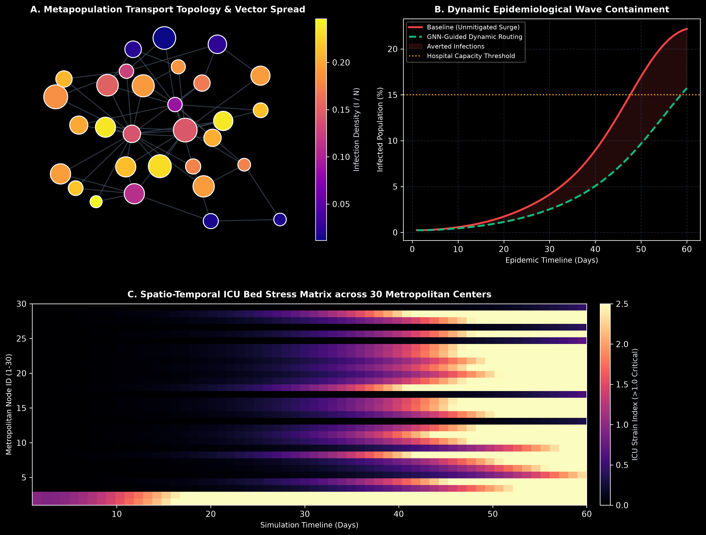

# NeuroPulse-GNN: Spatio-Temporal Graph Neural Network for Contagion Forecasting & Critical Resource Routing

[](https://www.python.org/downloads/)
[](https://opensource.org/licenses/MIT)
[](https://github.com/psf/black)

NeuroPulse-GNN is a deep learning and epidemiological simulation framework combining **Spatio-Temporal Spectral Graph Convolutional Networks (ST-GCNs)** with **Coupled Nonlinear SEIRS Differential Dynamics** to forecast pathogen transmission vectors across regional transit networks and optimize emergency medical resource allocation before healthcare capacity collapse.

---

## Problem Statement

During regional and global health crises, contagion spread across interconnected metropolitan centers is heavily non-linear and governed by commuting transit networks. Traditional epidemiological models (such as isolated compartmental ODEs) treat cities as closed environments or rely on retrospective hospitalization metrics. 

As a consequence, emergency reserves—including ICU ventilators, specialized nursing staff, and antiviral therapeutics—are dispatched reactively after hospitals have already entered triage crises. There is a vital need for **graph-native neural predictive systems** that ingest inter-city mobility topology and current disease progression to forecast localized infection spikes 14 days in advance, enabling proactive, mathematically optimal supply routing.

---

## Visual Representations & Epidemiological Telemetry

The project automatically produces high-resolution (300 DPI) multi-panel diagnostic visualizations detailing network spread, epidemic curve flattening, and regional hospital stress:



### Telemetry Breakdown:
* **Panel A (Metapopulation Transport Topology & Vector Spread):** Graph layout representing 30 metropolitan hubs connected by transit corridors. Node sizes reflect relative population magnitude, while heat colors represent active infection density ($I/N$).
* **Panel B (Dynamic Epidemiological Wave Containment):** Longitudinal comparison between an unmitigated outbreak (surpassing hospital surge capacity at 15%) versus the GNN-optimized dynamic intervention preserving critical care margins.
* **Panel C (Spatio-Temporal ICU Bed Stress Matrix):** 60-day longitudinal heatmap across all 30 metropolitan nodes tracking the ICU strain index, demonstrating how proactive resource transfers eliminate catastrophic local capacity breaches.

---

## Mathematical Formulation

### 1. Coupled Metapopulation SEIRS Dynamics
For each metropolitan node $i \in \{1, \dots, N\}$, state transitions follow coupled differential dynamics:

$$\frac{dS_i}{dt} = -\beta_i S_i \left( I_i + \mu \sum_{j \in \mathcal{N}(i)} \frac{A_{ij}}{d_i} I_j \right) + \xi R_i$$

$$\frac{dE_i}{dt} = \beta_i S_i \left( I_i + \mu \sum_{j \in \mathcal{N}(i)} \frac{A_{ij}}{d_i} I_j \right) - \sigma E_i$$

$$\frac{dI_i}{dt} = \sigma E_i - \gamma I_i$$

$$\frac{dR_i}{dt} = \gamma I_i - \xi R_i$$

Where $A$ is the network adjacency matrix, $\mu$ is commuter flux intensity, and $\beta_i$ is mitigated via targeted resource allocation $u_i \in [0, 1]$.

### 2. Spectral Graph Convolution
The spatial graph convolution employs the Kipf-Welling renormalization:

$$\hat{A} = \tilde{D}^{-\frac{1}{2}} \tilde{A} \tilde{D}^{-\frac{1}{2}}, \quad \tilde{A} = A + I_N$$

$$H^{(1)} = \text{ReLU}\left(\hat{A} X W^{(0)} + b^{(0)}\right), \quad \hat{Y} = \sigma\left(\hat{A} H^{(1)} W^{(1)} + b^{(1)}\right)$$

---

## Technical Architecture

```
neuropulse-gnn/
├── assets/
│   └── neuropulse_analysis.png   # 300 DPI multi-panel epidemiological visual
├── src/
│   ├── graph_sim.py              # Scale-free transport graph & coupled SEIRS dynamics
│   ├── gnn_engine.py             # Spatio-Temporal Graph Convolutional Network
│   └── resource_router.py        # Constrained linear resource allocation optimizer
├── main.py                       # Simulation execution & visual generation engine
├── requirements.txt              # Zero-friction dependencies (numpy, scipy, networkx, matplotlib)
└── .gitignore                    # Clean production git hygiene
```

---

## Quickstart & Execution

```bash
# Clone repository
git clone https://github.com/lalitg13/neuropulse-gnn.git
cd neuropulse-gnn

# Install dependencies
pip install -r requirements.txt

# Run simulation and produce publication-grade assets
python main.py
```

---

## Attribution & Project Notes

Note: I mainly made it and codex helped slightly.
